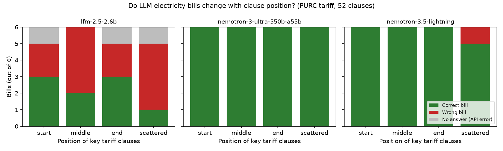

# Does clause order change an LLM's electricity bill?

A small experiment on input-order sensitivity, inspired by "Order Matters! An Empirical Study on Large Language Models' Input Order Bias in Software Fault Localization" (ICSE 2026).

The question: if a model calculates a bill from tariff rules, does the position of those rules in the prompt change the answer?



## Setup

- **Rulebook:** Ghana's official end-user electricity tariffs, published by the Public Utilities Regulatory Commission (PURC) on 16 June 2026 and effective 1 July 2026 ([source](https://purc.com.gh/attachment/346541-20260729120703.pdf)). Levies and taxes are left out, so the clauses given to the model are the whole rulebook.
- **Bills:** six cases. Residential customers at 25, 30, 31, 300 and 450 kWh (covering the lifeline cut-off at 30 kWh and the band change at 300 kWh), and a non-residential customer at 900 kWh.
- **Ground truth:** an exact calculator in `order_test.py`, with assert-based self-checks.
- **Scoring:** an answer is correct within GH₵0.05 of the exact bill.
- **Models:** free models on OpenRouter, temperature 0.

### v1: 12 clauses, six orders

The 12 key clauses in their original order, reversed, and four random shuffles (`order_test.py`).

### v2: 52 clauses, four positions

The 12 key clauses plus 40 filler clauses from the same PURC publication: wholesale electricity charges, natural gas, water and net metering. The water tariff has its own exclusive lowest band, like the electricity lifeline, so it looks like the rules that matter. The key clauses are placed at the start, the middle, the end, or scattered among the filler (`order_test_v2.py`).

## Results

### v1 (12 clauses)

| Model | Correct |
|---|---|
| Nemotron 3 Ultra 550B | 36/36 |
| Nemotron 3.5 Lightning | 36/36 |
| Laguna S 2.1 | 36/36 |

Order made no difference with a short rulebook.

### v2 (52 clauses)

| Model | Start | Middle | End | Scattered |
|---|---|---|---|---|
| Nemotron 3 Ultra 550B | 6/6 | 6/6 | 6/6 | 6/6 |
| Nemotron 3.5 Lightning | 6/6 | 6/6 | 6/6 | 5/6 |
| LFM 2.5 2.6B | 3/6 | 2/6 | 3/6 | 1/6 |

- The largest model was correct in every position.
- Both smaller models did worst with the rules scattered.
- Nemotron Lightning got the 31 kWh bill right in every position except scattered. There it returned GH₵63.16 instead of GH₵73.89, which is the energy charge without the monthly service charge. In that layout, the service-charge clause sat away from the rate clauses.
- LFM 2.5 2.6B is weak in every position. Three of its calls failed with API errors and are shown in grey in the chart.

## Limitations

- Six bills per condition, one run each, so the differences are suggestive, not significant.
- One scattered layout (seed 0) was tested; other shuffles may behave differently.
- Free models only; production models may behave differently.
- API failures during a network outage were re-run with `retry_failed.py`; three LFM calls still failed.

## Run it

```bash
export OPENROUTER_API_KEY=...
python3 order_test.py nvidia/nemotron-3.5-lightning:free       # v1
python3 order_test_v2.py nvidia/nemotron-3.5-lightning:free    # v2
python3 retry_failed.py                                         # re-ask calls that got no answer
pip install matplotlib && python3 make_chart.py                 # chart from results_v2_*.json
```

Author: Abdulai Mohammed Rafiq Nindow ([@mrnabdulai](https://github.com/mrnabdulai))
